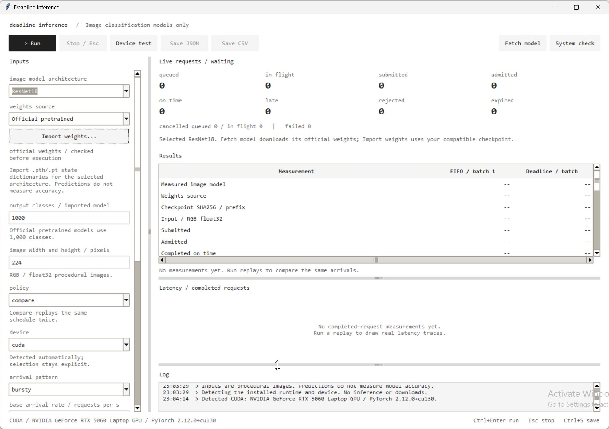
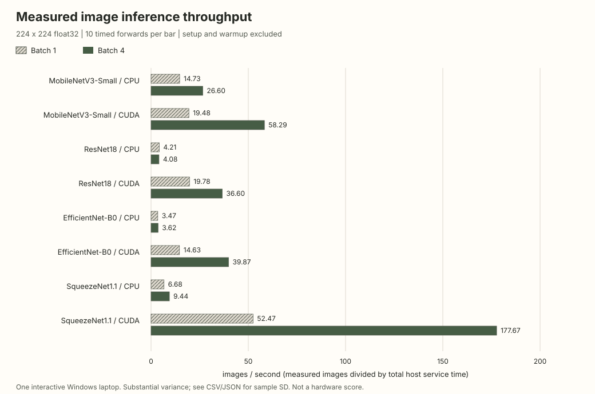
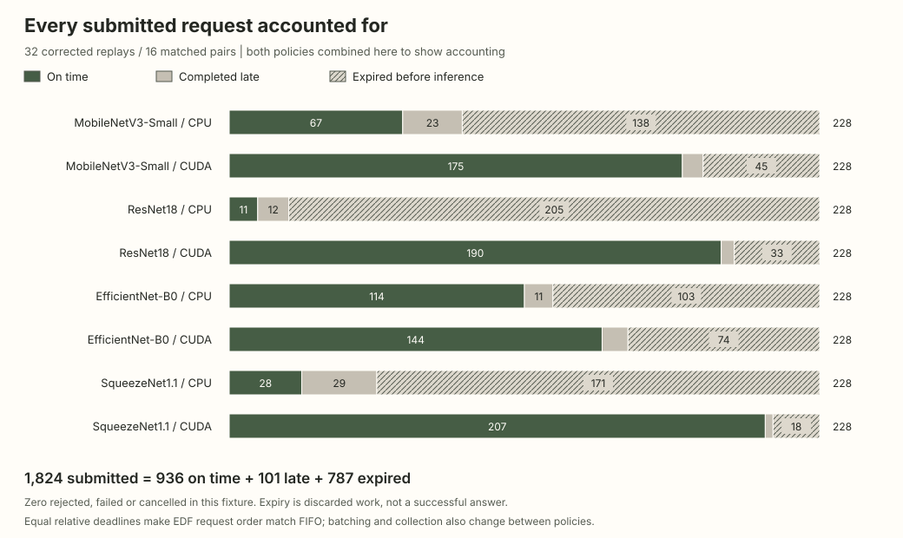
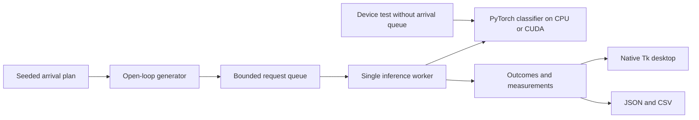

# Deadline Inference

**A native desktop lab for image-model performance and request scheduling.**

Find out how a classifier runs on your CPU or NVIDIA GPU, then replay the same
bursty traffic through two scheduling policies. Inspect timely answers, latency
and discarded work together, rather than treating throughput as the only result.

[Download for Windows](https://github.com/yassinabdelal-ipynb/deadline-inference/releases/latest)
· [Measured results](docs/public/README.md)
· [Model imports](docs/MODELS.md)
· [Learning guide](docs/LEARNING.md)
· [MIT license](LICENSE)



## Download and run

| Your computer | Start here |
| --- | --- |
| Windows x64, with or without an NVIDIA GPU | [Download the CPU application](https://github.com/yassinabdelal-ipynb/deadline-inference/releases/download/v0.3.1/DeadlineInference-Windows-x64-CPU.zip). No Python installation required. |
| Windows/Linux x64 with a supported NVIDIA GPU | Use the **CUDA source setup** below. The CPU download cannot execute CUDA. |
| Linux or macOS desktop | Use the source setup, starting with CPU. Native packages for these systems are not supplied. |

For the Windows download, extract the **entire ZIP** and open
`DeadlineInference/DeadlineInference.exe`. Keep its accompanying folders beside
the executable. Select **Fetch model** to download the selected official weights,
then **Device test**. Start with MobileNetV3-Small, image size 224 and batch 2.

No account, API key, password or paid service is needed to use the app. Downloads
need internet access; cached models run offline. Inputs and imported weights stay
on your computer. Weights are downloaded explicitly, hash checked and cached;
missing weights never silently become a random model. Release files include
[SHA256 checksums](https://github.com/yassinabdelal-ipynb/deadline-inference/releases/download/v0.3.1/SHA256SUMS.txt).
The Windows application is unsigned; checksums are not code signing.

Windows CPU and CUDA execution have been exercised on one Windows 11 laptop.
Other physical computers and other desktop operating systems still need their
own verification. See the [support matrix](docs/PORTABILITY.md).

## Two experiments

| Control | Question | Measurements |
| --- | --- | --- |
| **Device test** | How does this model execute on the selected device? | Repeated batch timing, images/second, model parameters and memory. No simulated request queue. |
| **Run → compare** | What happens when requests arrive independently of responses? | On-time/late/expired/rejected counts, completion rate, throughput, p50/p95/p99 latency, queue depth and generator lateness. |

**FIFO** means first in, first out: run the oldest live request, one image at a
time. **Deadline batching** selects the earliest deadline and groups compatible
images, subject to batch size, collection time and a calibrated runtime estimate.
Both queues are bounded. Both policies use the same admission and expiry rules.

Compare replays one immutable, seeded arrival plan sequentially through both
policies. It excludes preparation and warmup from steady-state measurements.
Every submitted request has one final outcome, including explicit cancellation
and failure categories. CUDA forward timing uses synchronized CUDA events;
end-to-end latency starts at the **planned arrival**, including generator delay.

**Current experimental limit:** all generated requests have the same relative
deadline and priority. Deadline order therefore matches arrival order. This
comparison changes batching and collection as well as scheduling; it does not
isolate an EDF ordering advantage. It implements established concepts, not a
claim to outperform production inference servers.

## Supported image models

| Family | Parameters | Official checkpoint download |
| --- | ---: | ---: |
| MobileNetV3-Small | 2,542,856 | 10.3 MB |
| ResNet18 | 11,689,512 | 46.8 MB |
| EfficientNet-B0 | 5,288,548 | 21.4 MB |
| SqueezeNet1.1 | 1,235,496 | 5.0 MB |

The app accepts official pretrained weights or trusted `.pth`/`.pt` tensor state
dictionaries matching one of these four architectures and the selected class
count. Import means a local file copy, not a remote upload. It does not load
arbitrary Python model programs. See [the exact import contract](docs/MODELS.md).

Procedural RGB images test **execution and scheduling**, not prediction
accuracy. Training, image generation, detection, segmentation, text/audio models,
ONNX and arbitrary architectures are outside this release.

## Observed results

The checked-in measurement snapshot covers **4 classifiers × 2 devices**,
**160 timed batch executions** after warmup and **32 corrected scheduling
replays / 16 matched comparisons**. It uses 224 × 224 float32 images on an RTX
5060 Laptop GPU with 8,151 MiB VRAM, driver 596.08, Windows 11 and PyTorch
2.12.0+cu130. CPU tests use two PyTorch threads.



Each bar has 10 timed samples. Rate is measured images divided by total **host
service time**, including assembly, transfer, inference and synchronization.
Variability was substantial in this interactive laptop session: EfficientNet-B0
CPU batch 4 was **1,105.95 ± 782.17 ms** per batch. These short observations are
not hardware rankings or sustained capacity guarantees. ResNet18 CPU illustrates
a useful counterexample: batch 4 measured **4.08 images/s**, versus **4.21** at
batch 1. Batching need not improve performance.



That second figure combines both policies to show accounting coverage; it is
**not a policy comparison**. Expired requests did not produce answers. Completed
latency percentiles exclude discarded requests, while deadline success uses all
submitted requests. Inspect both before drawing conclusions.

[Download the compact JSON](docs/public/measurements.json),
[profile CSV](docs/public/profiles.csv) and [per-replay CSV](docs/public/replays.csv).
The [measurement notes](docs/public/README.md) include sample counts, memory
scope, workload settings, the corrected arrival-clock defect and reproduction.

## Source setup

Use **64-bit Python 3.14 with Tcl/Tk**. Download the
[source archive](https://github.com/yassinabdelal-ipynb/deadline-inference/releases/download/v0.3.1/deadline-inference-source.zip)
or clone this repository, then run commands from its extracted folder. Paths
with spaces are supported. Setup creates a project-local `.venv`; no activation,
system compiler, CUDA toolkit, Docker, WSL or Node installation is required.

```powershell
# Windows CPU
py -3.14 scripts/bootstrap.py --backend cpu --download-weights
.\.venv\Scripts\python.exe -m deadline_engine desktop
```

```powershell
# Windows NVIDIA CUDA: use a compatible installed NVIDIA driver.
py -3.14 scripts/bootstrap.py --backend cuda --download-weights
.\.venv\Scripts\python.exe -m deadline_engine doctor
.\.venv\Scripts\python.exe -m deadline_engine desktop
```

```sh
# Linux/macOS CPU source route; physical desktop verification is pending.
python3.14 -m tkinter
python3.14 scripts/bootstrap.py --backend cpu --download-weights
./.venv/bin/python -m deadline_engine desktop
```

Linux NVIDIA users can choose `--backend cuda`; macOS uses CPU. AMD/Intel GPU,
ROCm, DirectML and Apple MPS acceleration are not implemented. Matching upstream
wheels, sufficient memory and a native desktop session are required. Some Linux
systems require their distributor's matching Tk package. Setup never changes
drivers, reboots or permanently relaxes PowerShell execution policy.

Dependencies are pinned in [the CPU set](requirements-cpu.txt) and
[the CUDA set](requirements-lock.txt). Setup refuses to replace an existing
environment's CPU/CUDA backend accidentally. Use a separate `--environment`
directory to keep both, or deliberately pass `--replace-backend` to switch.
[Full setup and portability notes](docs/PORTABILITY.md).

## Check your installation

1. Fetch MobileNetV3-Small and run **Device test** on CPU. Confirm the report
   identifies the actual device and contains measured timing samples.
2. Select compare, steady, 20 requests/s, 1 second, 1,000 ms deadline, batch 2,
   queue 32 and seed 7. Run and export JSON/CSV. Both policies must have the
   same schedule hash and exact terminal accounting. A slow result is a result.
3. Run a longer experiment and press Stop/Escape. The app should remain
   responsive and report cancelled requests explicitly. Ctrl+Enter runs;
   Ctrl+S saves JSON.
4. With the CUDA source installation, repeat on CUDA. A CPU-only build must
   identify itself and must not offer unsupported GPU execution.

```powershell
# Bounded reference and available native-widget tests; no model download.
.\.venv\Scripts\python.exe -m unittest discover -s tests -v
# Opt-in real CPU/CUDA tests after fetching weights.
powershell -NoProfile -ExecutionPolicy Bypass -File scripts/test.ps1 -Hardware
# A reproducible bounded scheduling benchmark.
.\.venv\Scripts\python.exe -m deadline_engine benchmark --device cpu --duration 1 --rate 40 --deadline 250 --batch 4 --repeats 2 --output results/my-benchmark
```

[Testing guide](docs/TESTING.md) · [Release notes](docs/RELEASE_NOTES.md) ·
[60–90 second demo](docs/DEMO.md)

The local 0.3.1 source verification passed **96 tests with no skips** in
**47.700 seconds**, including opt-in real CPU/CUDA model checks and release
infrastructure tests. A fresh native CUDA smoke test also passed on the actual
RTX 5060. This is local verification, separate from GitHub CI and separate-PC
desktop testing.

## Architecture and project boundaries



The scheduler and measurements are independent of the interface. Tk stays on
the main thread; model preparation and inference run on a dedicated background
worker. Charts do not run inside timing loops. [Project guide](docs/PROJECT.md)
maps source files, timing definitions and extension ideas.

This project implements the scheduler, workload replay, cancellation/accounting,
measurement pipeline and desktop controls. **PyTorch/torchvision provide the
models, pretrained weights and CPU/CUDA kernels.** There are no custom CUDA
kernels, model-accuracy results or research-novelty claims. The runtime estimate
is a heuristic, not a hard real-time guarantee.

Contributions should include a reproducible case and preserve request
conservation. Read [CONTRIBUTING.md](CONTRIBUTING.md),
[SECURITY.md](SECURITY.md) and [third-party notices](THIRD_PARTY_NOTICES.md).
Project code is MIT licensed; dependencies and checkpoints retain their own
licenses and terms.
